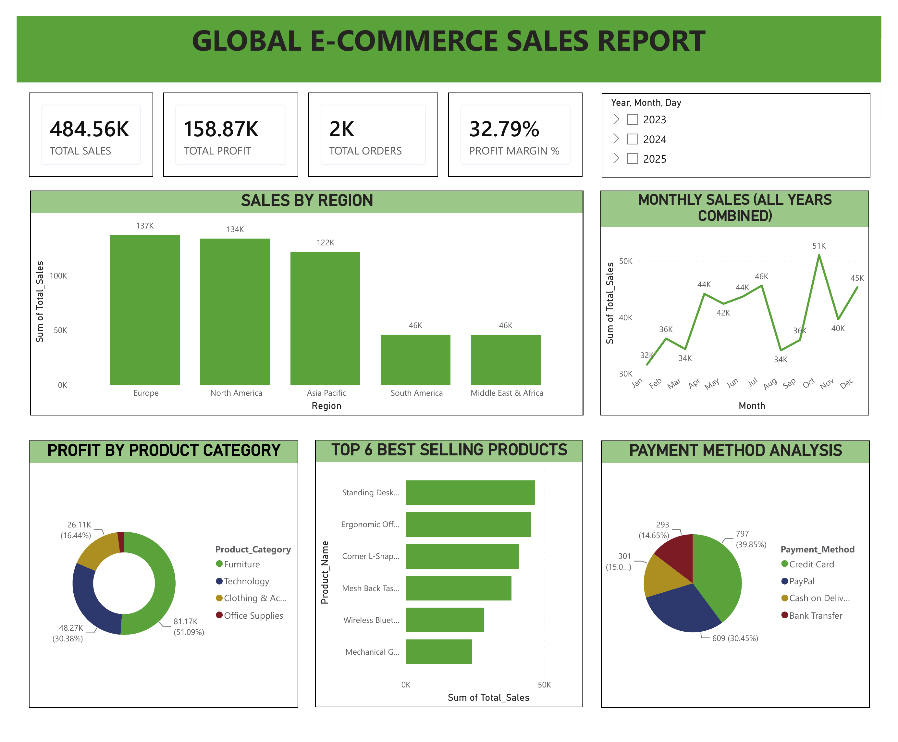

# Global E-Commerce Sales Dashboard (Power BI)

An interactive Power BI dashboard analysing 2,000 e-commerce orders from 2023 to 2025.

## Dataset
- 2,000 orders, 15 columns, 2 Jan 2023 to 31 Dec 2025, 20 countries, 5 regions
- Columns: Order_ID, Order_Date, Customer_Name, Customer_Segment, Country, Region, Product_Category, Product_Name, Quantity, Unit_Price, Discount_Percent, Total_Sales, Shipping_Cost, Profit, Payment_Method
- **Source:** Downloaded from Kaggle (public e-commerce sales dataset). The original page has since been updated, so the link is not included here. The data file is not included in this repository.

## What the dashboard shows
- KPIs: total sales 484.56K, total profit 158.87K, 2,000 orders, profit margin 32.79%
- Sales by region
- Profit by product category
- Top 6 best-selling products
- Payment method analysis
- Monthly sales pattern (all years combined), with a year/month/day slicer

## Key findings
- Europe, North America and Asia Pacific together generate about 81% of total sales.
- Furniture contributes about 51% of profit (81.17K) and Technology about 30% (48.27K).
- Credit card is the most used payment method, at about 40% of orders (797 of 2,000).
- Monthly sales peak in October (about 51K) and are lowest in January (about 32K), with all three years combined.
- Top 6 products by sales: Standing Desk Converter, Ergonomic Office Chair, Corner L-Shaped Desk, Mesh Back Task Chair, Wireless Bluetooth Headphones, Mechanical Gaming Keyboard.

## Files
| File | Description |
|------|-------------|
| `Global_ecommerce_sales_report.pdf` | PDF export of the dashboard |
| `dashboard.png` | Screenshot of the dashboard |

## Tools
Power BI Desktop, DAX (a `Month Number` column is used to sort months in calendar order).

## Notes
- The monthly chart combines the same calendar month across all years, so it shows seasonality and not growth over time.
- The figures in this README were checked against the dataset.
- Built with AI assistance.
